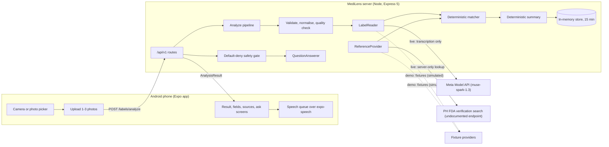

# MediLens AI — Architecture

## Overview



The phone never talks to Meta or the FDA and holds no keys. It talks only to the MediLens server
at `EXPO_PUBLIC_API_BASE_URL`.

## Repository layout

```
packages/contracts   Zod schemas and TypeScript types shared by app and server
apps/server          Express 5 API, pipeline, providers, domain rules (Vitest)
apps/mobile          Expo SDK 58 app with expo-router screens (jest-expo)
eval/                Label accuracy eval instructions (packs are git-ignored)
docs/                Spec, plan, research and project documents
```

## Server pipeline (one synchronous request)

`POST /api/v1/labels/analyze`:

1. **Validate** each upload: at most 8 MB, JPEG/PNG/WebP by content, pixel-count limit.
2. **Normalise**: auto-rotate, resize to 2048 px on the long edge, re-encode as JPEG, in memory.
3. **Quality check**: sharpness, luminance and glare. A failed check returns a
   `label_unreadable` result with reasons and **no model call**.
4. **Read**: `LabelReader` returns an `ExtractedLabel`: every field's value, legibility and
   evidence text. Live: Muse Spark with a JSON schema, one retry on invalid output, and a guard
   that discards output from any model whose id contains "contributor".
5. **Parse**: deterministic parsers for strength, registration number and dates.
6. **Look up**: `ReferenceProvider` searches the registry by registration number, then by name.
7. **Match**: pure deterministic rules produce a `MatchAssessment` (spec §5.4).
8. **Summarise**: a deterministic template produces display text and spoken chunks (spec §5.5).
9. **Store**: the `AnalysisResult` is kept in memory for 15 minutes for follow-up calls.

**The model only transcribes.** Verification status, matching, the summary and the safety gate
are deterministic code.

## Providers

| Interface | Live | Demo (simulated) |
|---|---|---|
| `LabelReader` | Muse Spark reader | `FixtureLabelReader`, by scenario id |
| `ReferenceProvider` | PH FDA search: 5 s timeout, 24 h cache, honest User-Agent, at most 2 lookups per scan | `FixtureReferenceProvider` |
| `QuestionAnswerer` | Deterministic answers from the label; only "explain this printed phrase" sends that printed field to Muse Spark, and its reply must pass a strict content gate or is dropped (the quote alone is spoken) | `FixtureAnswerer` (deterministic) |

`PROVIDER_MODE` selects live or demo for `/labels/analyze`. `/demo/*` always uses the fixture
providers, so one server serves both demo scenarios and live scans. In demo mode an uploaded
photo still gets real validation and quality checks, then is read as demo scenario s1 and marked
`isDemo: true`.

Live spend is metered per UTC day from each completion's token usage; once `DAILY_SPEND_CAP_USD`
is reached, live calls return `503 LIVE_BUDGET_EXHAUSTED`.

**Meta glasses are not part of the architecture.** They are roadmap only; there is no glasses
code or interface in this repository.

## Mobile app

expo-router screens: welcome and disclaimer, home, camera, preview, analyzing, result, label
fields, verification and sources, ask a question (preset buttons first, free text second),
safety, settings, and the demo scenario picker. Only settings and the disclaimer acknowledgement
are persisted (AsyncStorage). Photos exist only as temporary files in the app's cache directory
until they are uploaded (deleted after upload or on cancel; never written to the gallery), and
results are held in memory only. Speech is a
pure-TypeScript chunk queue over `expo-speech`.

## API

See [API_SPEC.md](API_SPEC.md).
