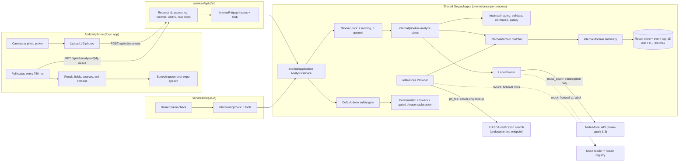

# MediLens AI — Architecture

Binding design: [the base spec](superpowers/specs/2026-10-27-medilens-design.md) as amended by
[the Go port spec](superpowers/specs/2026-10-28-medilens-go-port-design.md).

## Overview



The phone never talks to Meta or the FDA and holds no keys. It talks only to the MediLens API at
`EXPO_PUBLIC_API_BASE_URL`. The API and the MCP server are separate processes built from the same
packages and configured by the same environment; **each has its own in-memory store**, so an
analysis id from one is unknown to the other.

**Meta glasses are not part of the architecture.** They are roadmap only; there is no glasses
code or interface in this repository.

## Repository layout

```
go.mod                 module github.com/medilens-ai/medilens (Go 1.27)
services/api           REST + SSE API binary
services/mcp           MCP server binary (Streamable HTTP)
services/eval          live label accuracy eval (owner-run, costs money)
services/smoke         live smoke test (owner-run, costs money)
internal/config        env loading (stdlib .env loader), validation
internal/contracts     Go structs mirroring packages/contracts (identical JSON keys)
internal/domain        parsers, matcher, safety gate, summary, answers (pure, no I/O)
internal/jsregex       ECMAScript regex matcher for the safety patterns (lookarounds)
internal/imaging       validate, normalise, quality (parity with the Node sharp pipeline)
internal/ai            provider interfaces, Muse Spark adapters, mock, factory
internal/metaapi       hand-written net/http client for api.meta.ai chat completions
internal/references    PH FDA, fixture registry, TTL cache
internal/demo          the 8 demo scenarios
internal/application   AnalysisService: create, run, events, explain, speak, delete
internal/pipeline      analyze steps, result store, spend meter, event log
internal/httpapi       routes, handlers, error mapping, SSE, graceful shutdown
internal/middleware    request id, access log, CORS, rate limit, recover
internal/mcptools      MCP tools (typed in/out), auth, output caps
internal/observability slog JSON with redaction
internal/eval          eval scoring and smoke-test recorders
internal/parity        corpus loader for the parity tests
fixtures/parity        golden corpora recorded from the Node build
packages/contracts     Zod schemas (the app and the contract test use them)
apps/mobile            Expo SDK 58 app with expo-router screens (jest-expo)
scripts/contract       Zod contract test against the running Go API (root npm test)
scripts/parity         the Node recorder (restores apps/server from node-fallback-v1; see its README)
scripts/dev            cross-platform launchers for the root npm scripts
eval/                  label accuracy eval instructions (packs are git-ignored)
docs/                  spec, plans, research and project documents
```

The Node/Express server (`apps/server`) was the reference implementation. It was removed from
the tree after the Go build passed the parity corpora, the contract test and the mobile tests;
the tag `node-fallback-v1` keeps it. To re-record a corpus, restore only `apps/server` from
the tag onto the current branch, as [scripts/parity/README.md](../scripts/parity/README.md#re-recording)
describes: the tag predates `scripts/parity`, so a whole-tree checkout has no recorder.

### Falling back to Node

**NOT RUN** as a whole (written from the tag's own README). The current app speaks only the Go
contract (`/api/v1/analyses`, `/config/capabilities`), so a fallback needs the **whole tag tree**:
the Node server, the Node-contract app, and an APK built from it.

1. `git worktree add ../medilens-node node-fallback-v1` (a separate folder). The tag is local
   only: push it with the repository first (`git push <remote> node-fallback-v1`, owner).
2. In that folder: `npm install`, then `cp .env.example .env`. The Node build reads
   `PROVIDER_MODE` (`demo` by default; `live` with `MODEL_API_KEY`). Keep this `.env` apart from
   the Go one, which refuses `PROVIDER_MODE`.
3. `npm run dev -w @medilens/server` serves the Node API on `http://localhost:8787`.
4. Build the app from the same folder: `eas build --profile preview` in `apps/mobile`, with
   `apps/mobile/eas.json` pointing at the Node server's HTTPS address.

## Analysis pipeline (asynchronous)

`POST /api/v1/analyses` validates the upload synchronously (400/413/415), checks the daily budget
for a live model (503 `LIVE_BUDGET_EXHAUSTED`), and returns `202 {id, status: "processing"}`. A
worker then runs these steps; each one emits a progress event **only when it actually starts**
(a step that does not run is skipped, never faked):

1. `received`
2. `quality`: normalise (EXIF orientation, Lanczos3 fit inside 2048 px, never enlarging, JPEG
   q85, in memory) and measure sharpness, luminance and glare on the re-encoded JPEG. A failed
   check ends the analysis as `needs_attention` with reasons and **no model call**.
3. `reading`: `LabelReader` returns an `ExtractedLabel`: every field's value, legibility and
   evidence text. Live: Muse Spark with a strict JSON schema, one retry on invalid output, and a
   guard that discards output from a response whose model id is empty or contains
   "contributor".
4. `reviewing_fields`: deterministic parsers for strength and registration number, plus name and
   dosage-form normalisation. The expiry date is not parsed; it is kept and spoken exactly as
   printed (only the offline accuracy eval parses its month and year).
5. `checking_references`: `references.Provider` searches by registration number, then by name
   (at most 2 lookups).
6. `comparing`: pure deterministic rules produce a `MatchAssessment` (base spec §5.4).
7. `explaining`: a deterministic template produces display text and spoken chunks (§5.5).
8. `completed`, or `needs_attention` for a quality failure, a loose pill, no label or an
   unreadable label. `failed` means an error (`ANALYSIS_FAILED`, `OCR_FAILED`, ...).

The result is kept for 15 minutes for follow-up calls (`/result`, `/explanation`, `/speak`,
`/references`) and dropped on `DELETE`. Demo scenarios (`POST /api/v1/demo/scenarios`) run the
same pipeline from the read step with the fixture providers, so their events are genuine.

**The model transcribes and decides nothing.** Its only other use is explaining one printed
phrase in Q&A, after the safety gate, and that explanation is dropped unless it passes the
closed-vocabulary gate. Verification status, matching, the summary, the answers and the safety
gate are deterministic code.

## Providers

| Interface | `muse_spark` / `ph_fda` | `mock` / `fixture` (default) |
|---|---|---|
| `LabelReader` | Muse Spark vision transcription (`internal/ai/muse_spark.go` over `internal/metaapi`) | Mock reader: the fictional s1 label for any upload, model `"mock"` |
| `PhraseExplainer` | Muse Spark, sent only the whole printed field; the reply must pass the gate or is dropped | None (the printed text is quoted alone) |
| `references.Provider` | PH FDA search: 5 s timeout, 24 h cache of successful lookups, honest User-Agent | Fixture rows of demo scenario s1 |

`MODEL_PROVIDER` and `REFERENCE_PROVIDER` select the providers; there is **no fallback** between
them, and `muse_spark` without `MODEL_API_KEY` is a startup error. A result made with any mock or
fixture provider is `isDemo: true`. The active providers and model id are logged at startup and
returned by `GET /api/v1/config/capabilities`.

Why Muse Spark is also the OCR: on-device ML Kit needs an Expo dev build, Tesseract needs cgo,
and a third-party cloud OCR would send health images to a second vendor
([MUSE_SPARK_INTEGRATION.md](MUSE_SPARK_INTEGRATION.md)).

Live spend is metered per UTC day from each completion's token usage ($1.25 input and $4.25
output per million tokens); once `DAILY_SPEND_CAP_USD` is reached, live analyses and explanations
return `503 LIVE_BUDGET_EXHAUSTED`.

## Operational behaviour

- **Limits:** per-IP token buckets, 30/min for writes (POST, DELETE) and 240/min for reads, so
  polling is not throttled. `TRUSTED_PROXIES` (CIDR list, empty by default) names the only hops
  whose `X-Forwarded-For` is honoured. Deploy note: an `X-Forwarded-For` entry must be a bare
  IP address; a proxy that writes `1.2.3.4:5678` or a bracketed IPv6 address makes every client
  fall back to the proxy's own address, so all clients share one bucket (fails closed).
- **Uploads:** read only through `MultipartReader` with a 3 × 8 MiB + 64 KiB body cap and an
  8 MiB part cap; `ParseMultipartForm`/`FormValue`/`FormFile` are not used, so nothing spills to
  disk (a guard test points the temp dir at an empty directory and checks it stays empty).
- **Imaging:** magic-byte sniff, header-only size check (≤ 40 MP) before any decode, one decode
  at a time. Set `GOMEMLIMIT` in containers.
- **Logging:** `slog` JSON; the access log has method, route pattern, status, duration and
  request id only. Label text, questions, evidence and keys are redacted or never logged.
- **Shutdown:** SIGINT/SIGTERM → `/readyz` 503 → event streams closed → 10 s to drain →
  in-flight analyses cancelled.

## MCP server

`services/mcp` serves six typed tools over stateless Streamable HTTP at `/mcp` on
`127.0.0.1:8788` by default, with bearer-token auth (required off loopback). It builds the same
`AnalysisService` with the same providers. See [MCP_TOOLS.md](MCP_TOOLS.md).

## Mobile app

expo-router screens: welcome and disclaimer, home, camera, preview, analyzing, result, label
fields, verification and sources, ask a question (preset buttons first, free text second),
safety, settings, and the demo scenario picker. The app posts the photos to `/analyses`, polls
`GET /analyses/{id}` every 750 ms and shows and announces the real stage labels, then fetches
`/result`. A poll that fails for a passing reason (network, timeout, `429`, a proxy's `5xx` page)
is retried with backoff, honouring `Retry-After`, up to 3 failures in a row; when the app gives up,
it deletes the analysis, best effort (see [API.md](API.md#progress-events)). It uses polling rather than SSE because React Native EventSource / fetch streaming was
not verified. `GET /config/capabilities` replaces the old health check for mode detection
(`modelProvider: "mock"` shows "Server is in demo mode"). The app deletes the analysis when the
user leaves a result (best effort).

Only settings and the disclaimer acknowledgement are persisted (AsyncStorage). Photos exist only
as temporary files in the app's cache directory until they are uploaded (deleted after upload or
on cancel; never written to the gallery), and results are held in memory only. Speech is a
pure-TypeScript chunk queue over `expo-speech`.

## API

See [API.md](API.md).
